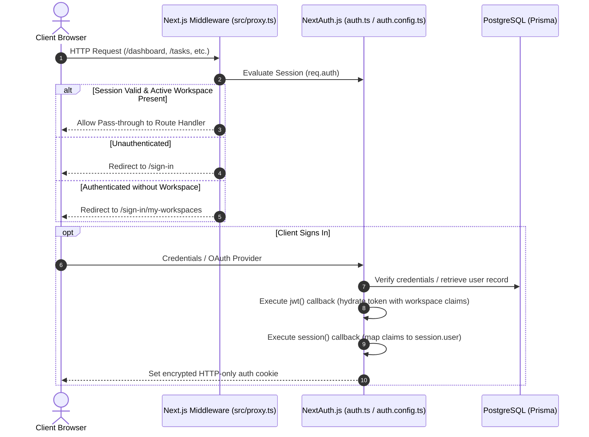
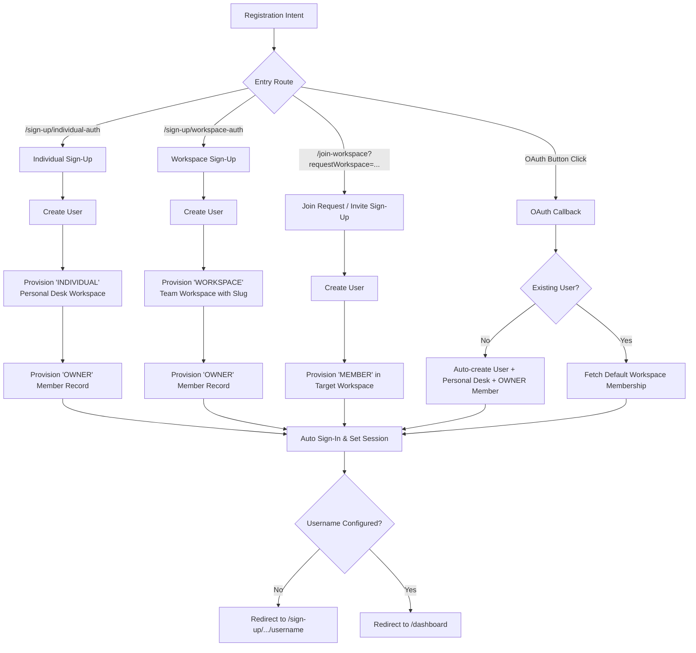
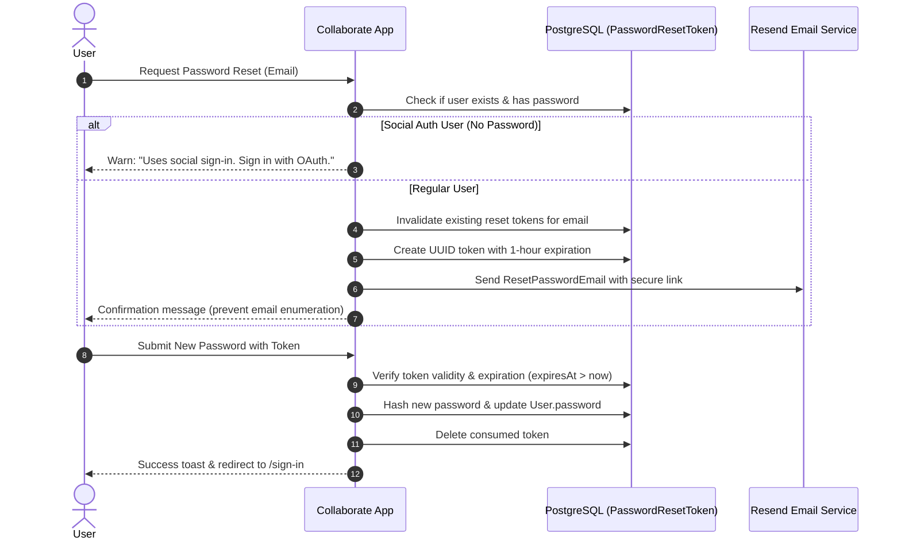
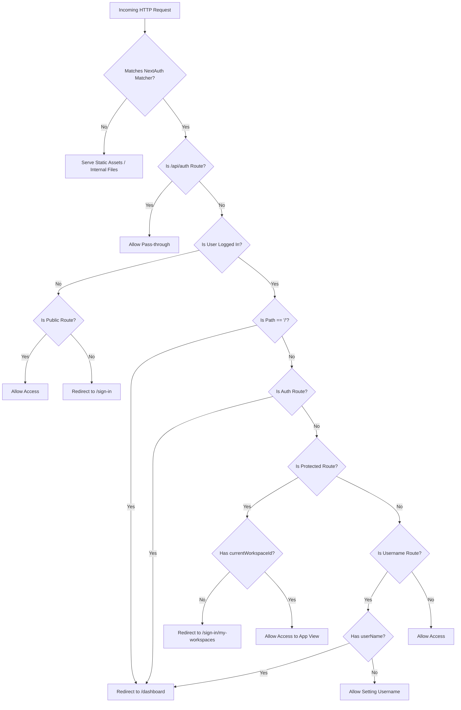

# Session & Authentication Architecture

This document provides a comprehensive technical reference for the identity, authentication, session management, and credential lifecycle systems implemented across the Collaborate platform.

---

## 1. Architectural Overview & Stack

Collaborate utilizes **Auth.js / NextAuth v5** operating in a stateless **JSON Web Token (JWT)** session mode backed by **Prisma Adapter** (`@auth/prisma-adapter`) and PostgreSQL.



### Core Tenets
1. **Stateless Scalability with JWT**: Authentication sessions are encoded into cryptographically signed and encrypted JSON Web Tokens, eliminating persistent database session lookups on every incoming request.
2. **Context-Enriched Sessions**: The JWT payload is augmented with the user's active workspace ID, desk mode, role, and member ID, enabling instantaneous server-side authorization without redundant database round-trips.
3. **Multi-Provider Account Convergence**: Support for Credentials (email/username + bcrypt) alongside social OAuth providers (Google and GitHub) with email account linking enabled.
4. **Automated Onboarding Handshake**: Every successful registration immediately provisions an initial workspace desk and binds an `OWNER` membership directly to the active session.

---

## 2. Authentication Providers & Strategies

Authentication configuration is split across [`auth.config.ts`](file:///c:/Users/USER/Documents/Projects/[frontend]/Personal/collaborate/auth.config.ts) (edge-compatible provider definitions) and [`auth.ts`](file:///c:/Users/USER/Documents/Projects/[frontend]/Personal/collaborate/auth.ts) (callbacks, database interactions, and session hydration).

### Supported Authentication Methods

| Provider | Strategy | Credentials / Scopes | Key Configuration & Behavior |
| :--- | :--- | :--- | :--- |
| **Credentials** | Identifier & Password | Email or Username + Plaintext Password | Verified against `db.user` via bcrypt. Supports dual-identifier lookup (email or username). |
| **Google** | OAuth 2.0 / OIDC | `email`, `profile` | `allowDangerousEmailAccountLinking: true`. Auto-provisions personal desk if new user. |
| **GitHub** | OAuth 2.0 | `read:user`, `user:email` | `issuer: "https://github.com/login/oauth"`, `allowDangerousEmailAccountLinking: true`. |

### Credentials Authentication Flow

In [`auth.config.ts`](file:///c:/Users/USER/Documents/Projects/[frontend]/Personal/collaborate/auth.config.ts), the Credentials provider verifies login attempts via `signInSchema`:

1. **Validation**: Input is parsed against `signInSchema`:
   - `identifier`: Must be a valid email or compliant username string (`^[a-z0-9_.]+$`).
   - `password`: Minimum 2 characters.
2. **Lookup**: `getUserByIdentifier(identifier)` executes an `OR` query against `User.email` and `User.userName`.
3. **Password Hash Verification**: `bcrypt.compare(password, user.password)` validates the password against the stored bcrypt hash.
4. **Principal Yield**: Upon successful match, an identity payload `{ id, email, fullName, userName }` is returned to the NextAuth lifecycle.

---

## 3. Registration & Onboarding Lifecycle

Collaborate supports distinct registration pathways tailored to individual users, organizations, and team invitations.



### 1. Individual Sign-Up (`individualSignUp`)
- Defined in [`src/lib/services/auth.services.ts`](file:///c:/Users/USER/Documents/Projects/[frontend]/Personal/collaborate/src/lib/services/auth.services.ts).
- Validates user payload via `signUpSchema` (password complexity requiring uppercase, lowercase, digit, and special character; 8+ chars).
- Creates `User` with bcrypt-hashed password (salt factor 10).
- Automatically provisions a dedicated **INDIVIDUAL** workspace:
  - `name`: `${user.fullName}'s Personal Desk`
  - `slug`: `${generateSlug(user.fullName)}-${user.id.slice(0, 6)}`
  - `teamSize`: `"1"`
- Creates initial `Member` record with role `OWNER`.
- Executes programmatic `signIn("credentials", { identifier: user.email, password, redirect: false })`.

### 2. Workspace Sign-Up (`workspaceSignUp`)
- Intended for teams establishing collaborative workspaces.
- Validates personal credentials via `signUpSchema` and workspace metadata via `workspaceCreateSchema` (name, slug, industryType, teamSize).
- Generates a collision-resistant unique slug via `generateUniqueSlugOnCreation(slug)`.
- Provisions the workspace under `DeskMode.WORKSPACE`.
- Creates `Member` record assigning the creator as `OWNER`.
- Programmatically signs in the newly registered owner.

### 3. Join Request & Invite Onboarding (`createAccountFromRequest`)
- Used when a non-authenticated user registers to fulfill an approved join request or invite link.
- Links the newly created `User` directly to the specified target `workspaceId` as a `Member` with `role: "MEMBER"`.
- Binds active workspace context directly into the resulting session.

### 4. OAuth Account Creation (`signIn` Callback)
- Implemented in the `signIn` callback in [`auth.ts`](file:///c:/Users/USER/Documents/Projects/[frontend]/Personal/collaborate/auth.ts).
- Triggered on Google or GitHub provider sign-ins.
- If the email does not exist in `db.user`:
  - Derives `fullName` and generates an initial sanitized `userName` from email prefix with random entropy if collisions occur.
  - Inserts `User` record into PostgreSQL.
  - Automatically provisions an `INDIVIDUAL` personal desk workspace and assigns the user as `OWNER`.
  - Attaches active workspace properties directly to the `user` object passed into the token generator.
- If the user already exists:
  - Fetches the user's earliest active workspace membership (`db.member.findFirst({ where: { userId }, include: { workspace: true }, orderBy: { createdAt: "asc" } })`).
  - Attaches that workspace context as the active session workspace.

---

## 4. JWT & Session Token Architecture

### Token Lifecycle & Callbacks

Collaborate configures session parameters:
```typescript
session: {
    strategy: "jwt",
    maxAge: 60 * 60 * 24 * 30, // 30 days
    updateAge: 60 * 60 * 24,       // 24 hours rolling update
}
```

```mermaid
flowchart LR
    subgraph Auth Pipeline
        UserObj[User Principal] -->|Sign-In| JWT_Init[jwt Callback: Init]
        ClientUpdate[useSession().update] -->|Trigger: update| JWT_Update[jwt Callback: Mutate]
        JWT_Init --> TokenStore[(Encrypted JWT)]
        JWT_Update --> TokenStore
        TokenStore -->|Incoming Request| SessionCallback[session Callback]
        SessionCallback --> SessionObj[session.user Object]
    end
```

### TypeScript Module Augmentation

Defined in [`next-auth.d.ts`](file:///c:/Users/USER/Documents/Projects/[frontend]/Personal/collaborate/next-auth.d.ts):

```typescript
declare module "next-auth" {
    interface Session {
        user?: {
            id: string;
            email: string;
            fullName: string;
            userName: string;
            currentWorkspaceId?: string;
            currentWorkspaceMode?: string;
            currentWorkspaceRole?: string;
            currentWorkspaceName?: string;
            currentMemberId?: string;
        } & DefaultSession["user"];
        error?: string;
    }

    interface User extends DefaultUser {
        id: string;
        email: string;
        fullName: string;
        userName: string;
        currentWorkspaceMode?: string;
        currentWorkspaceId?: string;
        currentWorkspaceRole?: string;
        currentWorkspaceName?: string;
        currentMemberId?: string;
    }
}

declare module "next-auth/jwt" {
    interface JWT {
        id: string;
        email: string;
        fullName: string;
        userName: string;
        currentWorkspaceId?: string;
        currentWorkspaceRole?: string;
        currentWorkspaceMode?: string;
        currentWorkspaceName?: string;
        currentMemberId?: string;
    }
}
```

### Token Callbacks Breakdown

#### 1. `jwt({ token, user, trigger, session })`
- **On Initial Authentication (`user` is present)**:
  - Copies core identity claims: `id`, `email`, `fullName`, `userName`.
  - Invocates helper `syncWorkspaceSessionFields` to capture `currentWorkspaceId`, `currentWorkspaceMode`, `currentWorkspaceRole`, `currentWorkspaceName`, and `currentMemberId`.
- **On Client Session Update (`trigger === "update"`)**:
  - Updates mutable profile fields (such as `userName`).
  - Dynamically overwrites active workspace claims using incoming payload fields passed to `update()`.

#### 2. `session({ session, token })`
- Projects decoded claims from `token` onto `session.user`.
- Ensures any server component calling `auth()` or client component using `useSession()` immediately accesses active workspace identifiers without touching the database.

---

## 5. Session Mutation Protocol (Workspace Switching & Profile Updates)

Client components mutate the active session in real-time using NextAuth's `useSession().update()` API:

```typescript
// Example: Switching workspace from client
const { update } = useSession();

await update({
    currentWorkspaceId: targetWorkspace.id,
    currentWorkspaceMode: targetWorkspace.mode,
    currentWorkspaceRole: targetMembership.role,
    currentWorkspaceName: targetWorkspace.name,
    currentMemberId: targetMembership.id,
});
```

### How Mutation Propagates:
1. Client calls `update(payload)`.
2. Auth.js transmits a `POST /api/auth/session` request containing the update payload.
3. The server triggers the `jwt` callback with `trigger === "update"` and `session === payload`.
4. `syncWorkspaceSessionFields(token, ...)` rebinds the JWT claims.
5. NextAuth signs a refreshed session cookie and returns it in the response headers.
6. The client React context reconciles with the refreshed claims without a full browser reload.

---

## 6. Password Management & Recovery

Password reset routines are managed via [`src/lib/services/password-reset.services.ts`](file:///c:/Users/USER/Documents/Projects/[frontend]/Personal/collaborate/src/lib/services/password-reset.services.ts) and backed by the `PasswordResetToken` table in Prisma.



### Token Schema
```prisma
model PasswordResetToken {
  id        String   @id @default(uuid())
  email     String
  token     String   @unique
  expiresAt DateTime
  createdAt DateTime @default(now())

  @@unique([email, token])
  @@map("password-reset-tokens")
}
```

### Security Safeguards
1. **Email Enumeration Prevention**: `requestPasswordReset` returns a generic success message even if the requested email is not present in the system.
2. **OAuth Isolation**: Users registered exclusively via OAuth (whose password hash is `null`) receive a clear directive explaining they must authenticate through their OAuth provider.
3. **Single Active Token Enforcement**: Any existing tokens for the email are deleted before a new token is generated.
4. **Ephemeral Validity**: Reset tokens expire strictly after 60 minutes (`expiresAt = Date.now() + 3600000`).

---

## 7. Routing Guard & Middleware (`src/proxy.ts`)

Perimeter route access is enforced via [`src/proxy.ts`](file:///c:/Users/USER/Documents/Projects/[frontend]/Personal/collaborate/src/proxy.ts), wrapping NextAuth's `auth()` handler.

### Route Classification Matrix

| Category | Route Definitions ([`routes.ts`](file:///c:/Users/USER/Documents/Projects/[frontend]/Personal/collaborate/routes.ts)) | Access Policy | Unauthenticated Action | Authenticated Action |
| :--- | :--- | :--- | :--- | :--- |
| **Public Routes** | `/`, `/join-workspace` | Accessible to everyone. | Render public page. | If logged in and browsing `/`, redirect to `/dashboard`. |
| **Auth Routes** | `/sign-in`, `/sign-up`, `/sign-up/*`, `/forgot-password`, `/reset-password` | Authentication portals. | Allow access. | Redirect to `/dashboard` (unless designated extended/username route). |
| **Protected Routes** | `/dashboard`, `/projects`, `/tasks`, `/members`, `/settings`, `/calendar`, `/activity`, `/notifications`, `/requests`, `/create-workspace` | Restricted to active members. | Redirect to `/sign-in`. | Allow access if `currentWorkspaceId` exists; otherwise redirect to `/sign-in/my-workspaces`. |
| **Extended Routes** | `/sign-in/my-workspaces` | Multi-workspace selector. | Redirect to `/sign-in`. | Allow access to pick or switch active workspace. |
| **Username Routes** | `/sign-up/individual-auth/username`, `/sign-up/workspace-auth/username` | Mandatory profile onboarding. | Redirect to `/sign-in`. | If user already configured `userName`, redirect to `/dashboard`. |
| **API Auth Routes** | `/api/auth/*` | NextAuth internal handlers. | Allow pass-through. | Allow pass-through. |

### Middleware Routing Decision Flow



---

## 8. Security Model & Best Practices

1. **HTTP-Only Cookies**: Session tokens are encrypted and transmitted exclusively via `HttpOnly`, `SameSite=Lax`, and `Secure` (in production) cookies, mitigating XSS token harvesting.
2. **Timing-Safe Password Comparison**: Password validation uses `bcrypt.compare` with constant-time characteristics against bcrypt cost-factor 10.
3. **Account Linking Safeguards**: `allowDangerousEmailAccountLinking: true` is configured strictly for trusted OAuth providers (Google and GitHub) whose primary verified email matches user input.
4. **Stateless Workspace Defense**: Protected routes verify that `currentWorkspaceId` exists directly on the verified JWT claims before granting access to tenant resources.
