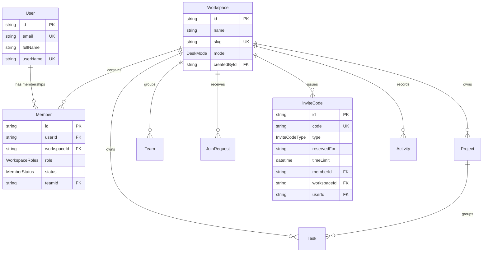
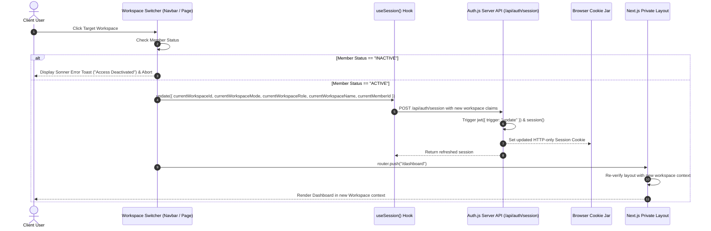
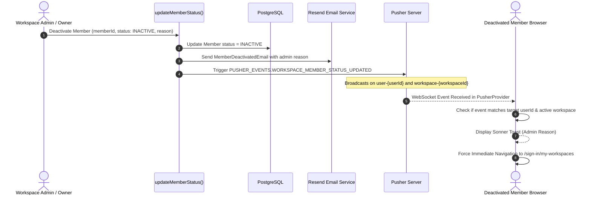
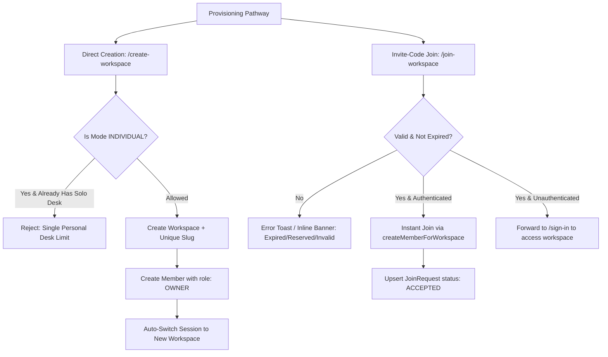

# Workspace Access & Persistence Architecture

This document provides a comprehensive technical reference for the multi-tenant workspace architecture, active session persistence, access enforcement, workspace switching workflows, and real-time eviction protocols implemented across Collaborate.

---

## 1. Multi-Tenancy Model & Data Hierarchy

Collaborate implements a **logical multi-tenant architecture** where users, organizations, and workspaces share a unified database instance while remaining strictly isolated through relational scoping.



### Core Tenets
1. **Separation of Identity & Tenancy**: A `User` represents a global identity (credentials, email, profile), while a `Member` defines their role, status, and permissions inside a specific `Workspace`.
2. **Dual Operating Modes (`DeskMode`)**:
   - **`INDIVIDUAL` (Personal Desk)**: Designed for solo professionals. Strictly single-member (`teamSize: "1"`), with team collaboration, join requests, and member invitations disabled. Every user is limited to a single personal desk.
   - **`WORKSPACE` (Team / Organization)**: Full multi-user collaboration supporting role hierarchies (`OWNER`, `ADMIN`, `MEMBER`), sub-teams, public/private join requests, invite codes, and activity feeds.
3. **Session-Bound Active Context**: The currently active workspace context is maintained directly inside the authenticated JWT session, granting instant access without requiring URL slug parsing or redundant database checks on every request.

---

## 2. Active Workspace Session Context

### Why Session-Embedded Tenancy?
Rather than relying on URL subpaths (e.g., `/:workspaceSlug/dashboard`) or client-side storage (e.g., `localStorage`), Collaborate persists active tenant state in the encrypted HTTP-only session token (`next-auth.jwt`). This design guarantees:
- **Tamper-Proof Authorization**: Context claims (`currentWorkspaceId`, `currentWorkspaceRole`, `currentMemberId`) are cryptographically signed on the server.
- **Zero-Latency Server Component Resolution**: Server components and Server Actions retrieve tenant identifiers directly via `await auth()` without incurring extra database round-trips.
- **Consistent Navigation**: Protected routes like `/dashboard`, `/projects`, and `/tasks` maintain clean, tenant-agnostic URLs.

### Active Workspace Payload Structure

Augmented in [`next-auth.d.ts`](file:///c:/Users/USER/Documents/Projects/[frontend]/Personal/collaborate/next-auth.d.ts) and synchronized in [`auth.ts`](file:///c:/Users/USER/Documents/Projects/[frontend]/Personal/collaborate/auth.ts):

| Field | Type | Description |
| :--- | :--- | :--- |
| `currentWorkspaceId` | `string` | Unique UUID of the currently selected workspace (`Workspace.id`). |
| `currentWorkspaceMode` | `DeskMode` | Operating mode: `"INDIVIDUAL"` or `"WORKSPACE"`. Governs visible UI navigation suites. |
| `currentWorkspaceRole` | `WorkspaceRoles` | Member authority: `"OWNER"`, `"ADMIN"`, or `"MEMBER"`. Determines RBAC privileges. |
| `currentWorkspaceName` | `string` | Human-readable workspace name displayed in badges and navigation headers. |
| `currentMemberId` | `string` | Direct UUID of the `Member` record (`Member.id`), used as foreign key for entity creation. |

---

## 3. Workspace Discovery, Selection & Switching

Collaborate provides two primary touchpoints for workspace navigation: the **Navbar Switcher Modal** and the dedicated **Workspace Selector Portal** (`/sign-in/my-workspaces`).



### 1. The Switcher Component (`ProtectedNavbar`)
Located in [`src/components/shared/layout/private/protected-navbar.tsx`](file:///c:/Users/USER/Documents/Projects/[frontend]/Personal/collaborate/src/components/shared/layout/private/protected-navbar.tsx):
- Receives the user's available memberships fetched server-side via `getMembersByUserID(user.id)`.
- Renders a modal listing each workspace with its name, mode, and member role.
- Prevents switching if the target workspace is already active (`id === activeWorkspaceId`).
- Upon selection:
  1. Shows a confirmation toast (`Switching workspace to ${name}`).
  2. Awaits `update(...)` to rehydrate session claims.
  3. Navigates to `/dashboard`, prompting server components to query data scoped to the new tenant.

### 2. The Workspace Selection Page (`WorkspaceView`)
Located in [`src/components/shared/layout/auth/workspace-view.tsx`](file:///c:/Users/USER/Documents/Projects/[frontend]/Personal/collaborate/src/components/shared/layout/auth/workspace-view.tsx) and served at `/sign-in/my-workspaces`:
- Used after initial sign-in if no workspace was automatically bound, or whenever a user explicitly navigates to their workspace index.
- Displays metadata badges (e.g., `OWNER`, `MEMBER`, project count, member count).
- Visual Deactivation Indicator: Deactivated memberships render with reduced opacity (`opacity-75`) and a red `Deactivated` badge. Clicks are intercepted with an informative error toast.

---

## 4. Access Enforcement & Defense in Depth

Access control is enforced at three distinct layers: Edge Middleware, Server Layout, and Service Layer.

```mermaid
flowchart TD
    Req[Incoming Route Request] --> L1[Layer 1: Edge Proxy Middleware]
    L1 -->|Protected Route & No Workspace Context| RedirSelector[Redirect to /sign-in/my-workspaces]
    L1 -->|Context Present| L2[Layer 2: Server Layout (app/private/layout.tsx)]

    L2 -->|Query Database| CheckStatus{Membership Status?}
    CheckStatus -->|INACTIVE| RedirSelector2[Redirect to /sign-in/my-workspaces]
    CheckStatus -->|ACTIVE| ModeCheck{Desk Mode?}

    ModeCheck -->|INDIVIDUAL| RenderSolo[Render Personal Navbar & Hide Team Tools]
    ModeCheck -->|WORKSPACE| RoleCheck{Workspace Role?}

    RoleCheck -->|OWNER / ADMIN| RenderAdmin[Render Admin Navbar]
    RoleCheck -->|MEMBER| RenderMember[Render Member Navbar]

    L2 --> L3[Layer 3: Service Layer Functions]
    RenderSolo --> L3
    RenderAdmin --> L3
    RenderMember --> L3
    L3 --> DB[(PostgreSQL Queries with workspaceId Isolation)]
```

### Layer 1: Edge Proxy Middleware (`src/proxy.ts`)
The proxy intercepts every request before it hits server components:
```typescript
if (isProtectedRoute && isLoggedIn && !user?.currentWorkspaceId) {
    return Response.redirect(new URL("/sign-in/my-workspaces", nextUrl));
}
```
If an authenticated user has no workspace bound to their JWT, they cannot access `/dashboard`, `/projects`, `/tasks`, or other protected routes.

### Layer 2: Server Layout Verification (`src/app/(private)/layout.tsx`)
Even with a valid cookie, server layouts perform real-time verification against the database:
```typescript
const session = await auth();
const user = session?.user;

if (!user) {
    redirect("/sign-in");
}

const { members } = await getMembersByUserID(user.id);

// Guard against deactivated members attempting entry
if (user.currentWorkspaceId) {
    const currentMembership = members.find(
        (m) => m.workspaceId === user.currentWorkspaceId,
    );
    if (currentMembership?.status === "INACTIVE") {
        redirect("/sign-in/my-workspaces");
    }
}
```
This ensures that if an administrator deactivates a user, their access is terminated on their very next server navigation, even if their JWT cookie has not yet expired.

### Layer 3: Service-Level Tenant Isolation
All backend services in `src/lib/services/` (e.g., `project.services.ts`, `task.services.ts`, `member.services.ts`) mandate `workspaceId` as a query predicate:
```typescript
// Strict multi-tenant query isolation
const projects = await db.project.findMany({
    where: {
        workspaceId: currentWorkspaceId,
    },
});
```

---

## 5. Membership Lifecycle & Real-Time Eviction

Member access states are governed by the `MemberStatus` enum:
- `ACTIVE`: Full operational access corresponding to assigned workspace role.
- `INACTIVE`: Account is suspended; privileges are instantly revoked across the workspace.



### Real-Time Pusher Eviction (`PusherProvider`)
Implemented in [`src/components/providers/pusher-provider.tsx`](file:///c:/Users/USER/Documents/Projects/[frontend]/Personal/collaborate/src/components/providers/pusher-provider.tsx):
- Automatically subscribes each logged-in client to their personal channel `user-{userId}` and their active workspace channel `workspace-{workspaceId}`.
- Listens for `WORKSPACE_MEMBER_STATUS_UPDATED`:
```typescript
const handleStatusUpdated = (data: MemberStatusUpdatedEventPayload) => {
    if (
        data.userId === user?.id &&
        data.status === "INACTIVE" &&
        (!user?.currentWorkspaceId || data.workspaceId === user.currentWorkspaceId)
    ) {
        toast.error(
            data.reason
                ? `Your access to ${data.workspaceName || "this workspace"} has been deactivated: "${data.reason}"`
                : `Your access to ${data.workspaceName || "this workspace"} has been deactivated by an administrator.`,
            { duration: 8000 },
        );
        router.push("/sign-in/my-workspaces");
    }
};
```
- When triggered, active users are evicted immediately without waiting for page refreshes or route changes.

### Real-Time Workspace Presence Tracking
- In addition to eviction signals, `PusherProvider` automatically subscribes to `presence-workspace-${user.currentWorkspaceId}`.
- Tracks active workspace team member presence in real-time (`pusher:subscription_succeeded`, `pusher:member_added`, `pusher:member_removed`).
- Exposes `onlineUserIds` and `isUserOnline(userId)` to all workspace views, powering online status dots across the protected navbar, members table (with live filtering), project views, and task assignment sheets.

---

## 6. Workspace Provisioning & Onboarding Flows



### 1. Workspace Creation (`createWorkspace`)
In [`src/lib/services/workspace.services.ts`](file:///c:/Users/USER/Documents/Projects/[frontend]/Personal/collaborate/src/lib/services/workspace.services.ts):
- Validates payload via `extendedWorkspaceCreateSchema`.
- **Solo Desk Constraint**: Queries existing workspaces where `createdById === currentUser.id && mode === "INDIVIDUAL"`. If one exists, blocks creation to prevent duplicate personal desks.
- **Slug Generation**: Calls `generateUniqueSlugOnCreation(slug)` to append random alphanumeric suffixes in the event of slug collisions.
- Provisions `Workspace` and automatically inserts a `Member` record assigning the creator as `OWNER`.

### 2. Workspace Join Flow via Invite Code (`/join-workspace`)
In [`src/components/forms/join-workspace.tsx`](file:///c:/Users/USER/Documents/Projects/[frontend]/Personal/collaborate/src/components/forms/join-workspace.tsx) and [`src/lib/services/request.services.ts`](file:///c:/Users/USER/Documents/Projects/[frontend]/Personal/collaborate/src/lib/services/request.services.ts):
- Joining an existing workspace is strictly invitation-driven. Public workspace searching and uninvited message-to-admins requests have been removed from the join view.
- Prospective members provide their **Full Name**, **Email Address**, and a valid **Invite Code** (e.g., `INV-XXXX-XXXX`), or access via direct invitation link (`/join-workspace?code=...`).
- When a valid invite code is entered, the target workspace is automatically resolved and verified, displaying a verified workspace status badge.
- When submitted:
  - Validates code status, expiration, and target recipient (if `RESERVED`).
  - Blocks any `INACTIVE` (deactivated) members with a deactivation alert.
  - Authenticated users are joined immediately via `createMemberForWorkspace`, upserting a `JoinRequest` record marked as `ACCEPTED`.
  - Unauthenticated users have their request recorded as `ACCEPTED` and are routed to sign in or create an account to finalize access.

### 3. Invite Codes (`inviteCode`)
In [`src/lib/services/invite.services.ts`](file:///c:/Users/USER/Documents/Projects/[frontend]/Personal/collaborate/src/lib/services/invite.services.ts):
- Workspace Owners and Admins generate invite codes via `/invite-codes` (`OPEN` for anyone with the code, or `RESERVED` for a specific email address) with configurable expiration (`timeLimit`).
- Reserved codes dispatch customized invitation emails via Resend with direct redemption links (`/join-workspace?code=...&email=...`).
- Deactivated (`INACTIVE`) members are strictly prevented from re-joining with invite codes.

---

## 7. Persistence Guarantees & Synchronization

### 1. Cookie & Token Persistence
- NextAuth session cookie uses encrypted JWE/JWT signed with `AUTH_SECRET`.
- Configured with `maxAge: 30 days` and a rolling `updateAge: 24 hours`.
- Workspace switches overwrite cookie headers via `useSession().update(...)`, ensuring persistence across browser restarts.

### 2. Cross-Tab Synchronization
- NextAuth's internal `BroadcastChannel` synchronizes session changes across open browser tabs.
- When an active workspace is switched in Tab A, Tab B receives the session update event and refreshes local session state.

### 3. Server-Side Revalidation
- Data mutations in server actions invoke `revalidatePath(...)` across relevant routes (`/dashboard`, `/projects`, `/members`, `/settings`).
- This purges Next.js full-route cache and client router cache, ensuring fresh data for the newly active workspace.
